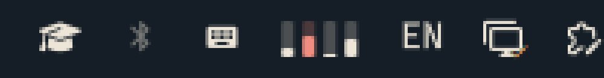

# Keyboard Backlight RGB

Omarchy bar widget for the keyboard backlight of Clevo/Tongfen laptops
(for example Avell). It controls the `rgb:kbd_backlight` LED.

- Left click: open the control panel. Use its power button to toggle the backlight.
- Scroll: change the brightness.
- Right click: cycle through six colors, starting from the active preset when possible.
- Control panel: set brightness with a slider, choose a color preset, enter any `#RRGGBB` color, or apply the current theme accent.
- Save up to eight favorite colors for quick access; favorites persist in the user's XDG state directory.
- Escape or click outside the panel to close it. Arrow keys move between controls; Enter or Space activates the selected control.
- Optional hook: paint the keyboard with the theme accent color on every theme change.

The panel reports when the keyboard LED is unavailable and shows a permission hint if a color write fails. UI transitions provide feedback; animated effects on the physical keyboard depend on driver and device support and are not provided by this plugin.

## Requirements

- An Omarchy shell with plugin support.
- A laptop whose keyboard backlight is driven by
  [tuxedo-drivers](https://github.com/tuxedocomputers/tuxedo-drivers)
  (AUR: `tuxedo-drivers-dkms`). Check that `/sys/class/leds/rgb:kbd_backlight` exists.
- `brightnessctl` (ships with Omarchy).

## Install

1. Install the plugin and enable it:

       omarchy plugin add https://github.com/cesarfilho/Omarvel --enable

2. Install the kernel driver and load it:

       omarchy pkg aur add tuxedo-drivers-dkms
       sudo modprobe -a tuxedo_keyboard clevo_wmi clevo_acpi tuxedo_io

3. Optional, only for color. Brightness works without this. The color file is
   root-only by default, so this rule gives the `input` group write access and
   loads the driver at boot. Review both files first; they are the only system
   files this plugin touches, and nothing is written without you running these lines:

       sudo install -m644 90-kbd-backlight.rules /etc/udev/rules.d/
       sudo install -m644 modules-load.conf /etc/modules-load.d/tuxedo.conf
       sudo udevadm control --reload && sudo udevadm trigger -s leds

   Your user must be in the `input` group.

4. Optional, follow the theme accent:

       omarchy hook install theme-set kbd-theme-hook.sh

## Remove

    omarchy plugin remove io.github.cesarfilho.kbd-backlight
    rm ~/.config/omarchy/hooks/theme-set.d/kbd-theme-hook.sh
    sudo rm -f /etc/udev/rules.d/90-kbd-backlight.rules /etc/modules-load.d/tuxedo.conf
    sudo udevadm control --reload

The driver stays installed. Remove it with `sudo pacman -Rns tuxedo-drivers-nocompatcheck-dkms`
if nothing else needs it.

## Helper

`kbd.sh` does the hardware work and can be used on its own:

    kbd.sh status | toggle | step +10 | step -10 | brightness 50 | color '#0a84ff' | theme
    kbd.sh favorite list | add '#0a84ff' | remove '#0a84ff'

## License

MIT. External dependency: tuxedo-drivers (GPL-2.0), installed separately.
